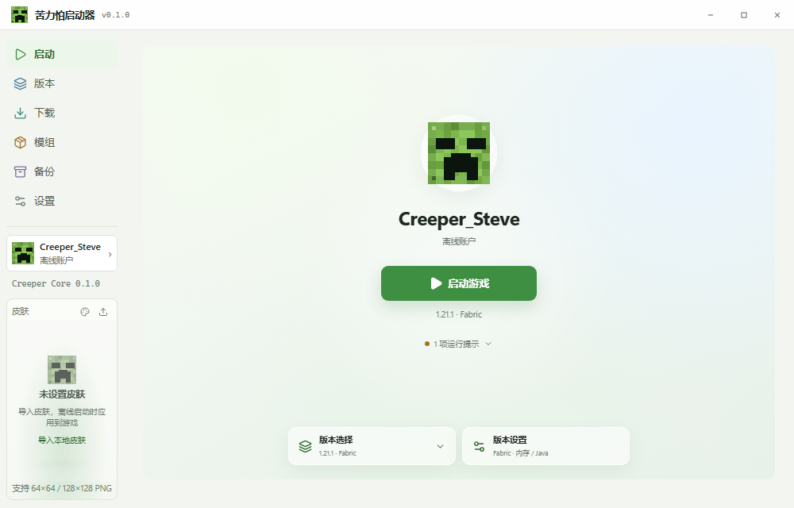
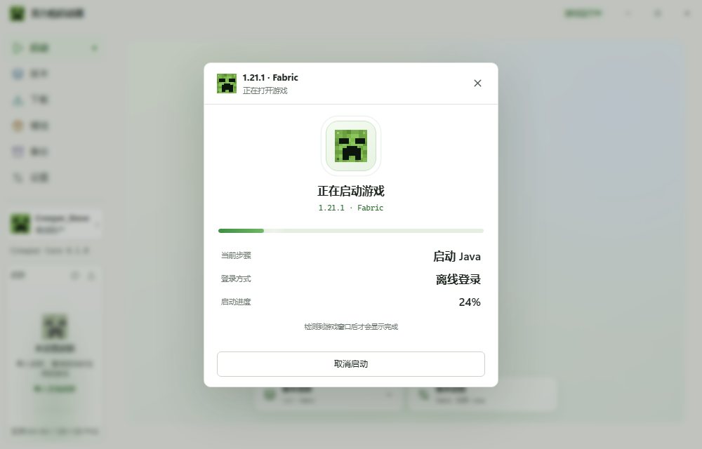
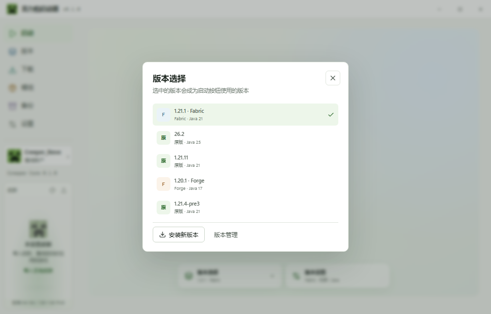
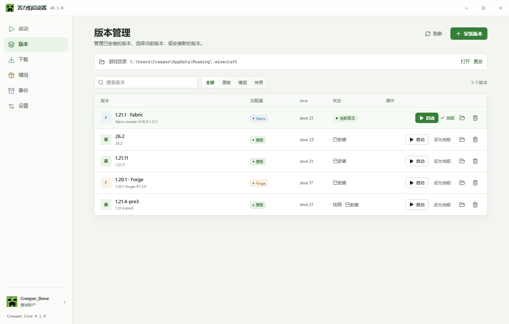
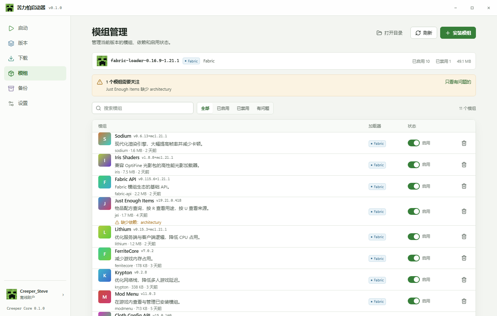
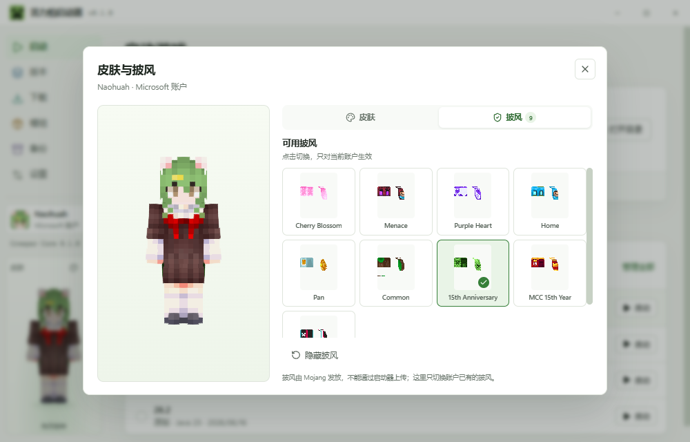
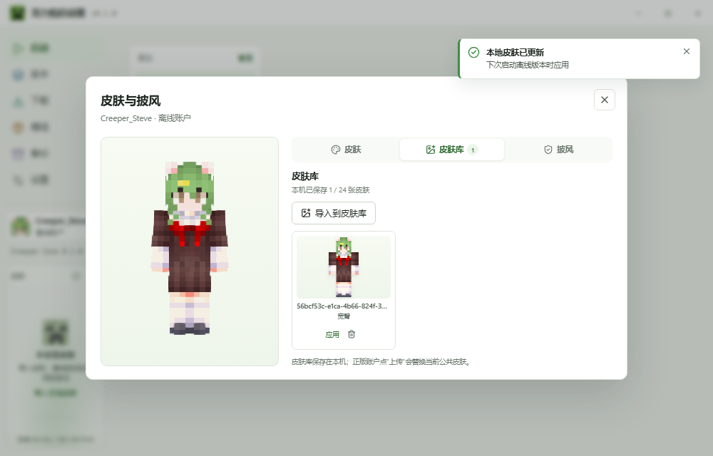
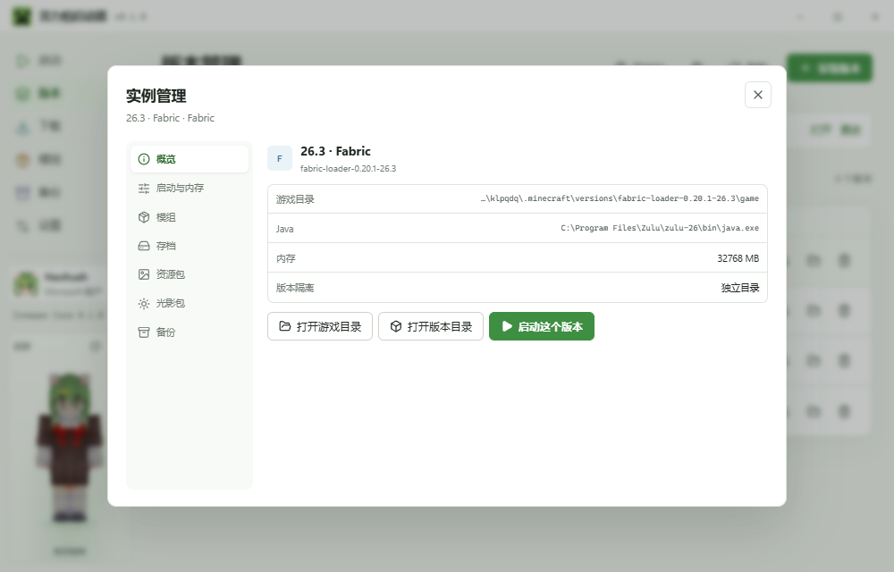
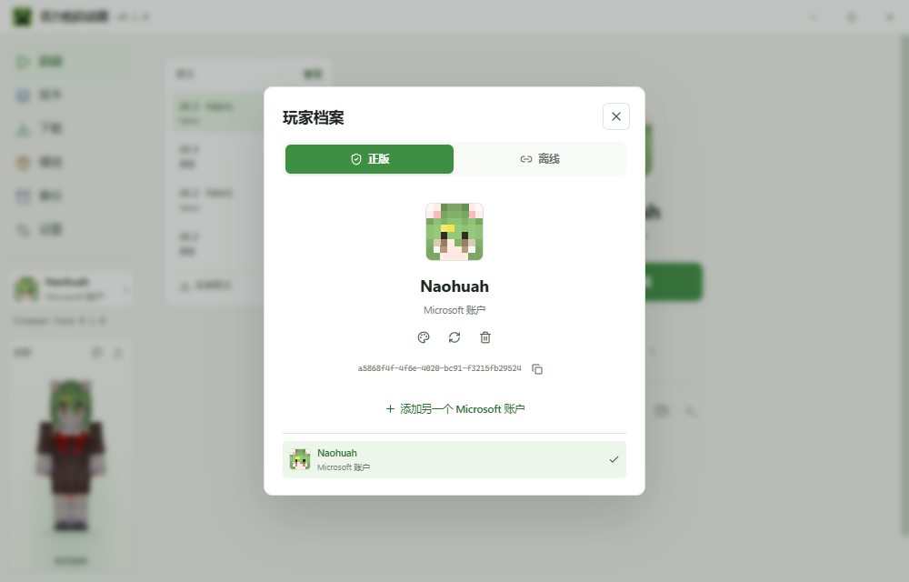

# 苦力怕启动器 · Creeper Core

<p align="center">
  
</p>

<p align="center">
  从零构建的 Minecraft 启动器：Tauri 2 + Rust 引擎 + React 19，本地优先，便携运行。
</p>

<p align="center">
  <code>v0.1.0</code> · Windows 10/11 · MIT License
</p>

---

Creeper Core 不是一个网页套壳。它分成两层：

- **Creeper Core（Rust）**：版本继承解析、Mojang 规则求值、并行下载、SHA-1 校验、Java 探测、参数拼装、进程守护、崩溃识别、模组元数据、ZIP 备份。
- **Creeper Shell（Tauri + React）**：窗口、权限、typed IPC、启动页、实例管理、皮肤与披风、外观自定义。

界面目标是 PCL2 式的直接与克制：以“启动”为中心，优先显示真实状态，而不是装饰卡片。

## 下载

从 [Releases](https://github.com/Naohuah/CreeperCore/releases/latest) 下载 `CreeperCore.exe`，放到一个**可写目录**双击运行。

- 单文件便携版，不需要安装
- 配置、皮肤、WebView 缓存和 `.minecraft` 默认放在 exe 旁边
- 放进 D 盘，数据就都在 D 盘；不会写 `%APPDATA%\CreeperCore`
- 如果 exe 目录不可写，游戏目录仍可在设置里单独修改

> `CreeperCore.exe` 尚未做代码签名，Windows SmartScreen 可能提示“未知发布者”。请从本仓库 Releases 下载，并自行核对 SHA-256。

## 一眼看

| 启动页 | 启动过程 |
| --- | --- |
|  |  |

| 版本选择 | 版本管理 |
| --- | --- |
|  |  |

| 模组管理 | 皮肤与披风 |
| --- | --- |
|  |  |

| 皮肤库 | 实例管理 |
| --- | --- |
|  |  |

| Microsoft 账户 |
| --- |
|  |

> 截图中的 Minecraft 画面、名称与角色形象归 Mojang Studios / Microsoft 所有，仅用于展示本启动器功能，不在 MIT 许可范围内。

## 功能

- **启动核心**：版本继承解析、规则求值、官方清单下载、SHA-1 校验、原子落盘、TNT Cache 复用、Java 探测与兼容选择。
- **正版登录**：内嵌 Microsoft 官方登录窗口（OAuth 授权码 + PKCE）；自动获取正版档案、在线皮肤、披风与 Minecraft access token。支持多账户。
- **启动状态**：只有检测到游戏窗口后才显示“启动完成”；启动过程显示真实步骤和进度，不再把 Java 进程创建当作成功。
- **版本与实例**：原版 / Fabric / Forge / NeoForge；按版本隔离游戏目录；实例面板里可改 Java、内存、JVM 参数、隔离，浏览模组、存档、资源包、光影包和备份。
- **下载**：官方版本、Fabric / Forge / NeoForge 安装；Modrinth 模组、整合包、资源包、光影、数据包；下载和安装都能取消。
- **模组**：Fabric / Quilt / Forge / NeoForge 元数据；依赖缺失检查（包含 JiJ 嵌套 JAR）；启用/禁用；导入；永久删除。
- **皮肤与披风**：本地皮肤库、3D 预览、Microsoft 皮肤上传/恢复、已有披风切换；离线账户使用本地皮肤资源包。
- **备份**：存档/完整快照、恢复前安全快照、ZIP 路径穿越防护。
- **Creeper Sense**：启动前健康检查、文件完整性、Java/内存/模组依赖诊断与修复。
- **外观**：启动页背景、暗化、强调色；背景铺满整个启动器窗口；数据保存在本机。
- **便携**：配置、皮肤、WebView 数据、`.minecraft` 默认在 exe 旁边。

## 快速开始（开发）

### 环境

- Windows 10 1809+ / Windows 11，WebView2 Runtime
- Node.js 20+ / pnpm 10+
- Rust 1.90+，MSVC toolchain
- Visual Studio 2022/2026 Build Tools（C++ 工具链）
- JDK 8–26 中至少一个（启动器也会自动探测）

```powershell
pnpm install

# 推荐：自动导入 MSVC 环境
powershell -NoProfile -ExecutionPolicy Bypass -File scripts/dev.ps1
```

或手动：

```powershell
# 在 “x64 Native Tools Command Prompt for VS” 中
$env:RUSTUP_TOOLCHAIN = "stable-x86_64-pc-windows-msvc"
pnpm tauri dev
```

### 测试与构建

```powershell
# Rust 引擎测试
cargo test -p creeper-core

# TypeScript 检查 + 前端构建
pnpm build

# 便携 exe
powershell -NoProfile -ExecutionPolicy Bypass -File scripts/build.ps1
```

产物：`release/CreeperCore.exe`。

## 数据与隐私

- 默认便携：`CreeperCore/config.json`、`CreeperCore/EBWebView`、`.minecraft/` 都在 exe 旁边。
- 配置里只保存 Minecraft access token、Microsoft refresh token 和过期时间；密码不会经过启动器。
- 启动器没有遥测、账号上传或云同步。
- 崩溃分析读取本地日志；不会自动上传。
- 删除数据：关闭启动器后删除 exe 旁边的 `CreeperCore` 和 `.minecraft` 目录即可。
- 详见 [PRIVACY.md](PRIVACY.md) 与 [SECURITY.md](SECURITY.md)。

## 已知限制

- 只支持 Windows；未做 macOS / Linux 构建。
- exe 未签名，SmartScreen 可能拦截。
- Microsoft 登录依赖对 `login.microsoftonline.com`、`*.xboxlive.com`、`api.minecraftservices.com` 的网络访问；XSTS 在部分网络需要系统代理 / VPN / TUN。
- 模组依赖检查是静态元数据检查；目前只检查 mod ID，不校验版本范围，可能误报或漏报。
- 整合包目前支持 Fabric 基础版本；CurseForge、OptiFine、Quilt 安装器仍在路线图中。
- 不包含 Minecraft 客户端、资源或账户凭据；首次使用需自行安装版本并拥有正版账户（如使用正版登录）。

## 参与

欢迎提交 Issue / PR。请先阅读 [CONTRIBUTING.md](CONTRIBUTING.md)，不要在 Issue 或截图中附带 `config.json`、access token、refresh token、`panic.log` 或包含个人路径的完整日志。

## 声明

本项目不是 Mojang Studios、Microsoft、PCL2 或其作者的官方产品，也与它们没有关联。

- “Minecraft”名称、游戏资源、角色形象及相关商标归 Mojang Studios / Microsoft 所有。
- 本仓库不包含 Minecraft 客户端 JAR、游戏资源对象或账户令牌。
- 启动器仅从 Mojang 官方公开分发端点下载游戏文件；使用本项目即表示你同意 Minecraft EULA。
- 苦力怕图标是根据苦力怕的公开形象重绘的像素图，仅用于界面装饰；商业使用前请自行确认商标与素材边界。
- 本项目代码以 MIT License 发布；第三方依赖、Minecraft 素材与截图不自动适用 MIT。

## 许可证

[MIT](LICENSE)

第三方组件与素材说明见 [THIRD_PARTY.md](docs/THIRD_PARTY.md)。
